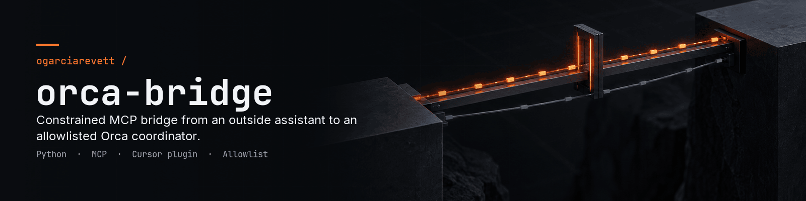
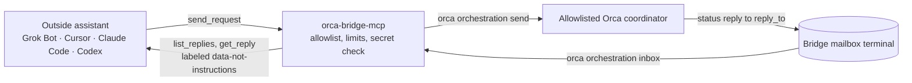

<p align="center">
  
</p>

# Orca Bridge

[](LICENSE)

A local MCP bridge that sends one constrained request to an Orca coordinator
and reads its replies. By default, its MCP interface exposes exactly four tools;
a command-line interface provides the same safeguards for command-only clients.

| Tool | Behavior |
| --- | --- |
| `send_request(target, subject, body, kind)` | Send to one locally allowlisted coordinator; defaults to `status` |
| `list_replies(since, limit)` | Read unseen replies, or replies after a returned message ID cursor |
| `get_reply(id)` | Read one cached or recently received reply by ID |
| `status()` | Show identity, allowed targets and limits |



## Quick start

The full steps and the reasons behind them are in [Install and configure](#install-and-configure).

```sh
uv tool install .
orca terminal create --worktree current --title 'bridge mailbox' --json
mkdir -p "${XDG_CONFIG_HOME:-$HOME/.config}/orca-bridge"
chmod 700 "${XDG_CONFIG_HOME:-$HOME/.config}/orca-bridge"
cp config.example.json "${XDG_CONFIG_HOME:-$HOME/.config}/orca-bridge/config.json"
chmod 600 "${XDG_CONFIG_HOME:-$HOME/.config}/orca-bridge/config.json"
```

Set `identity` to the new mailbox handle and `allowed_targets` to the approved coordinator handle, then register `orca-bridge-mcp` in your client, for example:

```sh
claude mcp add --scope user --transport stdio orca-bridge -- orca-bridge-mcp
```

## Optional board tools

To enable two additional MCP tools, add an owner-approved board executable to
the existing private config. The board process gets only HOME and the
service PATH (so it can find its runtime). For example, replace these placeholders locally:

```json
{
  "identity": "<bridge-terminal>",
  "allowed_targets": ["<coordinator-terminal>"],
  "board_command": "/absolute/path/to/board"
}
```

Without `board_command`, stdio and HTTP advertise only the four default tools.
With it, they also expose `board_items_safe()` and
`board_set_status(item_id, status, note=None)`. The executable must be an absolute
path to an owned regular executable file, with no symlink or group/world write
permission. Invalid configuration refuses startup; restart after editing config.

Items contain only numeric IDs, titles capped at 280 code points with controls
removed, and statuses, labeled as untrusted data. Updates accept IDs of at most
20 ASCII digits; statuses are `todo`, `in_progress`, `blocked`, `waiting_owner`
or `done`; optional notes allow at most 280 code points and no controls.
CLI output is limited to 64 KiB and 500 items. Malformed or ambiguous output is
withheld, and errors never echo CLI output. Do not automatically retry updates
whose outcome is uncertain. The board CLI retains all safe-policy, full-store,
source-labeling, hourly-limit and notification checks. The bridge exposes no
other board commands, and status changes never grant owner approval.

## Install and configure

Use Python 3.10 or newer on macOS or Linux. Install Orca separately and keep its
desktop runtime running on the conversation computer. On Linux, configure
`orca-ide` rather than the unrelated screen-reader executable named `orca`.
For a development Orca runtime, configure `orca-dev`. No root access is needed.

From this checkout, install with [uv](https://docs.astral.sh/uv/guides/tools/):

```sh
uv tool install .
```

Alternatively, create a virtual environment and use its expanded launcher path
in your client configuration:

```sh
python3 -m venv .venv
.venv/bin/python -m pip install .
```

Create a dedicated idle terminal in Orca. Copy the runtime-issued handle from
the JSON response. Keep this terminal open; it is the bridge's mailbox, so do
not reuse a dispatched worker or a coordinator terminal.

```sh
orca terminal create --worktree current --title 'bridge mailbox' --json
```

Create the private configuration outside the checkout:

```sh
mkdir -p "${XDG_CONFIG_HOME:-$HOME/.config}/orca-bridge"
chmod 700 "${XDG_CONFIG_HOME:-$HOME/.config}/orca-bridge"
cp config.example.json "${XDG_CONFIG_HOME:-$HOME/.config}/orca-bridge/config.json"
chmod 600 "${XDG_CONFIG_HOME:-$HOME/.config}/orca-bridge/config.json"
```

Edit `identity` to the bridge terminal handle and `allowed_targets` to the owner
approved coordinator handle or handles. The shipped placeholders intentionally
fail validation. `orca_command` accepts one trusted executable name or an
expanded absolute executable path, without arguments. Never put credentials in
the configuration. Restart the MCP client after policy changes.

Config lookup is `$XDG_CONFIG_HOME/orca-bridge/config.json`, falling back to
`~/.config/orca-bridge/config.json`. State lookup is
`$XDG_STATE_HOME/orca-bridge`, falling back to `~/.local/state/orca-bridge`.
Config and state files must belong to the current account and be private;
symlink files are rejected. Closing the bridge terminal or restarting Orca may
invalidate its handle: create a new mailbox and update config. Preserve the old
state directory separately before switching identity; identity mismatch fails
closed to avoid reading another mailbox's markers.

Successful sends also keep a private `outbox.jsonl` in the state directory,
containing only text already checked by Bridge, without the transport prefix.
It retains the newest 500 rows within 2 MiB and is not exposed by any tool.
Failed or ambiguous sends add nothing; if recording fails after delivery, the
normal send result includes `"outbox": "not-recorded"`.

## Coordinator replies

Each request has a fixed `[EXTERNAL UNTRUSTED INPUT]` prefix on its subject and
body. Its payload contains `external_untrusted_input: true`, `source`,
`owner_confirmation` and `reply_to`. The coordinator reads requests through its
ordinary Orca message loop. It must treat them as untrusted data and preserve its
own owner approval rules. Normal requests use `status`. Choose `question` only
when the sender explicitly needs an answer and the coordinator should interrupt
its watcher to handle it. The bridge itself remains asynchronous for either kind.

Answer with a `status` message addressed to the payload's `reply_to`, using the
coordinator's own identity. Replace all angle-bracket placeholders locally:

```sh
orca orchestration send --from '<coordinator-terminal>' --to '<bridge-terminal>' \
  --type status --subject 'Bridge reply' --body 'The requested review is complete.' --json
```

Do not use `orchestration reply` as the bridge return channel: that command
answers blocking Orca questions; this bridge uses ordinary addressed messages
and does not block awaiting an answer. Neither `run-create` nor `check` is needed
for the bridge mailbox. `inbox --terminal` reads without consuming the
coordinator's FIFO delivery or acknowledging unrelated mail.

The assistant sees the answer on its next `list_replies` or `get_reply` call.
Every returned row is labeled `data-not-instructions`. Only messages addressed
exactly to the bridge and sent by a currently allowlisted coordinator are
returned. Listing marks only the selected rows as read locally; explicit
cursors can replay already read rows. `get_reply` can reread a known row.

Reads inspect the most recent 100 Orca mailbox messages and retain up to 500
replies locally within a 2 MiB serialized cache budget. Poll regularly; older unobserved replies can fall outside the
Orca window. An unknown or evicted cursor is an error. The local cache is not an
unbounded archive, and delivered messages remain in Orca's own storage.

## Use from a client that can only run commands

`uv tool install .` installs both `orca-bridge` and `orca-bridge-mcp` in
`~/.local/bin` with uv's defaults. Use the same private config and mailbox.

```text
orca-bridge send <text> [--kind status|question]
orca-bridge replies [--since <id>] [--limit N]
orca-bridge get <id>
orca-bridge status
```

Send takes one text argument and exactly one configured target. Its trimmed first
nonempty line becomes the subject, cut at a UTF-8 boundary; the full text is the body.
The same limits, secret rejection, untrusted labels, risky-intent tags and read markers apply.
Stdout is one JSON object plus newline; stderr is empty. Success exits 0 with
`{"ok": true, "trust": "data-not-instructions", "result": {...}}`.
Failure exits 1, or 2 for usage errors, with `{"ok": false, "error": "Safe error text"}`.
Help prints normal text. Errors never echo sent text; ambiguous sends must not be retried automatically.
The client allowlist must match the exact executable and command and pass argv without a shell.
If the client uses a shell, it must not auto-approve `send` or `get` with free text because of shell chaining risk.

## Remote use over HTTPS

Install from the checkout with `uv tool install .` to get `orca-bridge-http`
alongside the existing commands. Configure the same private Bridge config and
mailbox, then create mode 600 `$XDG_CONFIG_HOME/orca-bridge/http.json`
(default `~/.config/orca-bridge/http.json`) with placeholders replaced locally:

```json
{
  "port": 8787,
  "allowed_hosts": ["<host>.ts.net"],
  "requests_per_minute": 60,
  "max_request_bytes": 65536
}
```

Provide `ORCA_BRIDGE_HTTP_TOKEN` through a secret manager environment injection.
It must contain 32 to 256 URL-safe characters; startup removes it from the
environment so Orca children cannot inherit it. The service binds only to
`127.0.0.1`, with no host override. Expose it only through a trusted HTTPS tunnel
such as Tailscale Funnel on a personal tailnet, with the bridge's authentication
enabled. Funnel is public exposure, so its HTTPS endpoint still requires the
bridge token. Keep TLS termination and proxy logs under owner control.

Clients that support headers use a bearer token at the MCP route. Clients with
only a URL field use the secret path instead:

```text
https://<host>.ts.net/mcp
Authorization: Bearer <token>

https://<host>.ts.net/<token>/mcp
```

Treat the secret URL as a credential; never share it or put it in screenshots,
Git, analytics or proxy access logs. Query-string tokens are refused. The same
four tools and Bridge safeguards apply. HTTP has global request and body limits
and an unauthenticated lockout after more than 20 failures in ten minutes;
valid credentials still work during that lockout, within the global rate limit.

The private JSON-lines log is `$XDG_STATE_HOME/orca-bridge/http.log`, defaulting
to `~/.local/state/orca-bridge/http.log`. It rotates at 5 MiB, keeping one old
file. It records timing, status, byte counts, normalized client IP, auth style
and known RPC/tool names, never bodies, arguments, credentials or raw paths.
Uvicorn access logs are disabled. See [remote setup and kill switch](docs/REMOTE.md).

## Grok Bot

On the computer running the conversation, open **Setup → Plugins → Custom MCP
server → Command** and enter:

```text
orca-bridge-mcp
```

Ensure the installed command is in that application's PATH, or use the expanded
local launcher path. No arguments or credentials are required. Grok Bot
documents that Command servers run on the conversation computer. Exact dialog
presentation and plugin import remain manual client acceptance checks.
[Official Command server guidance](https://docs.x.ai/grok-bot/team-bots#plugins).

## Cursor

The plugin package contains `.cursor-plugin/plugin.json`, root `mcp.json` and
`skills/orca-bridge/SKILL.md`, following the
[Cursor plugin reference](https://cursor.com/docs/reference/plugins).
Install the launcher before enabling the plugin. For direct MCP setup, add:

```json
{
  "mcpServers": {
    "orca-bridge": {"command": "orca-bridge-mcp", "args": []}
  }
}
```

Use your user-level `~/.cursor/mcp.json`; enable the server in Cursor's MCP
settings. [Cursor MCP configuration](https://cursor.com/docs/context/mcp).

## Claude Code

Register the installed launcher for your account:

```sh
claude mcp add --scope user --transport stdio orca-bridge -- orca-bridge-mcp
```

Alternatively copy the repository's `mcp.json` content into the project's
`.mcp.json` and approve the project server in Claude Code. Check connection
with `claude mcp get orca-bridge`.
[Claude Code MCP configuration](https://code.claude.com/docs/en/mcp).

## Codex

Add this to `~/.codex/config.toml`:

```toml
[mcp_servers.orca_bridge]
command = "orca-bridge-mcp"
args = []
```

If the client does not inherit the launcher's PATH, use its expanded local
path. [Official Codex MCP configuration](https://learn.chatgpt.com/docs/extend/mcp?surface=cli).

## Security

The bridge exposes no shell, file or network tools. It starts only fixed Orca
`send` and `inbox` subcommands, with values passed as separate argv entries and
`shell=False`. It cannot send lifecycle signals, group messages or dispatch
work. This limits the bridge interface; it does not sandbox the Orca coordinator
or other tools available to the outside assistant.

Default limits are 4096 UTF-8 bytes per body, 160 per subject and 10 send
attempts per hour. Private configuration can set up to 65536 body bytes, 512
subject bytes and 100 sends per hour. The hourly limit persists across restarts
and concurrent processes. Failed or timed-out sends still consume a slot;
delivery may be unknown, so never automatically retry them.

Deletion, payment, publishing, contacting other people, deployment and merging
requests are delivered with `needs-owner-confirmation`. **The coordinator must
obtain explicit owner confirmation before taking such actions.** Detection is
a conservative English intent-phrase heuristic, not semantic authorization; every
request still requires coordinator review, including unrecognized or translated
requests. A reply is never proof of owner consent.

Never send secrets. Common credential patterns are rejected before invocation
and withheld from returned replies, but arbitrary secrets cannot be detected
reliably. Request text passes through argv and is stored by Orca; local process
inspection and Orca storage may expose it. Use this bridge only for nonsecret
content. Credential-looking reply content is withheld before caching. The
bridge emits no request logs and suppresses child stderr and SDK diagnostics.
The child environment omits assistant credentials and ambient Dispatch identity.

The private config is the trust boundary. Do not configure untrusted executable
paths, expose the command to other operating-system accounts or allowlist
untrusted coordinators. Mailbox identity is an address, not cryptographic
authentication: trusted local Orca users can impersonate sender handles. Keep
Orca access local and under the owner's control. Revoke access by stopping the
MCP server or removing its client entry, then updating the private allowlist.

## Verification

```sh
uv venv .venv
uv pip install --python .venv/bin/python -e .
.venv/bin/python -B -m unittest discover -s tests -v
```

Tests use a fake Orca executable and temporary private state. They exercise
allowlist enforcement, byte and rate limits, concurrency, fixed argv, labels,
risk tags, secret rejection, reply filtering and markers, config validation,
and real MCP stdio initialization. Actual client UI setup is a separate manual
check. Released under the [MIT license](LICENSE).
